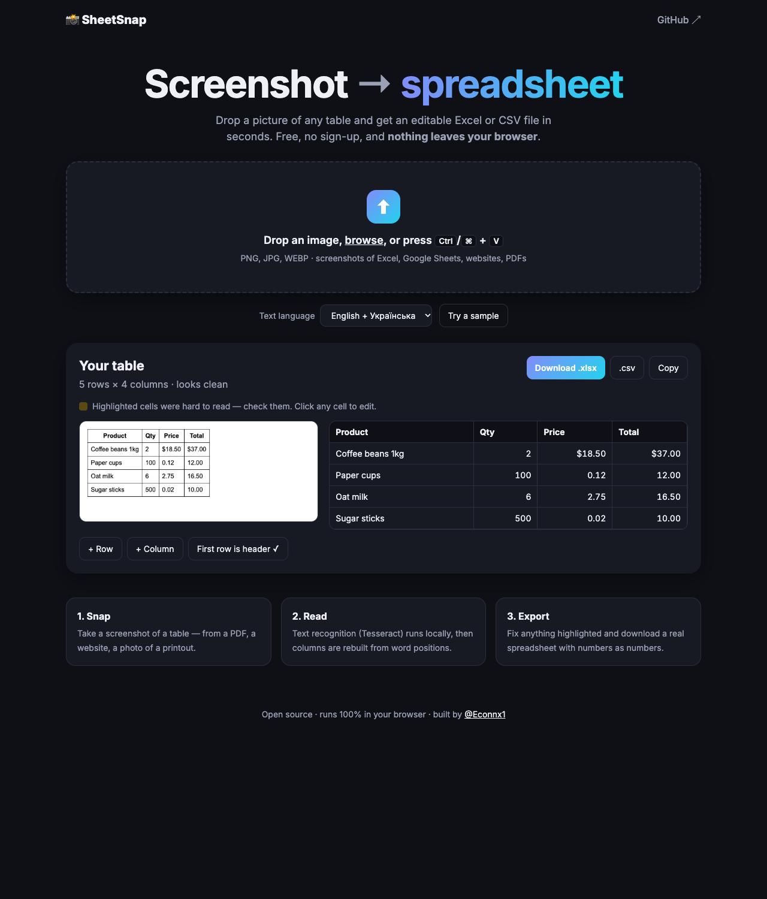

# 📸 SheetSnap

**Screenshot → spreadsheet.** Drop a picture of any table and get an editable Excel or CSV file.
Free, no sign-up, and nothing leaves your browser.



## Features

- **Drag & drop, browse or paste** (`Ctrl/⌘ + V`) a screenshot
- Works with tables from Excel, Google Sheets, websites, PDFs — with or without grid lines, light or dark theme
- **English, Ukrainian and Russian** text
- Cells that were hard to read are **highlighted**; every cell is editable
- Export to **.xlsx** (numbers stay numbers, `1 234,56` → 1234.56, `12%` → 0.12), **.csv**, or copy straight into Sheets
- **100% client-side** — the image is processed on your device

## How it works

1. **Clean-up** (`preprocess.js`) — grayscale, upscaling of small screenshots, dark-theme inversion and
   removal of long straight lines (table borders), which otherwise confuse OCR.
2. **OCR** — [Tesseract.js](https://github.com/naptha/tesseract.js) returns every word with its bounding box.
3. **Table rebuild** (`table.js`) — words are grouped into rows by vertical overlap; columns are the empty vertical
   strips that no cell crosses. Look-alike Latin/Cyrillic letters (`A`/`А`, `B`/`В`) are fixed per column.

## Run locally

```bash
git clone https://github.com/econnx/sheetsnap.git
cd sheetsnap
python3 -m http.server 8000   # then open http://localhost:8000
```

No build step, no dependencies to install.

## Known limits

- Small fonts can turn `%` into `9` — check highlighted cells before exporting.
- Merged cells and tables inside tables are not supported yet.
- Photos taken at an angle work worse than straight screenshots.

## Roadmap

- [ ] Receipts mode (item / price)
- [ ] Multiple tables per image
- [ ] Crop selection before reading

---

Built by [@Econnx1](https://x.com/Econnx1) · MIT License
